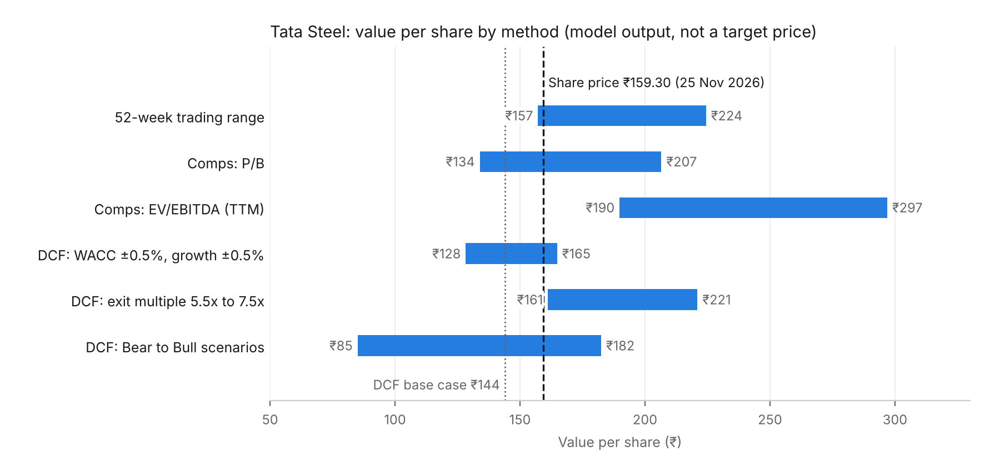

# Tata Steel valuation model

My three-statement model and DCF valuation of Tata Steel (NSE: TATASTEEL), built from the company's annual reports for FY23 to FY26 and its H1 FY27 results. It forecasts to FY31, values the company on free cash flow, and checks the answer against peer multiples.

*This is a personal learning project, not investment research. The values here are what the model gives under my assumptions; they are not a target price or a buy/sell view.*

## What I found

With market data as of 25 November 2026, my base case DCF comes out at about **₹144 per share**, against a share price of ₹159.30 that day. The bear and bull cases give ₹85 and ₹182.

A few things stood out while building it:

- **Peers say one thing and the DCF says another.** On trailing EBITDA, JSW Steel, Jindal Steel and SAIL trade at a median of about 10.8x, while Tata Steel trades at 7.7x. Apply the peer multiple to Tata Steel and you get ₹190 to ₹297. I don't think that's fair, though. The Indian peers are almost entirely domestic, while about a third of Tata Steel's revenue comes from Europe, and the UK business lost ₹2,569 crore at the EBITDA level in FY26. That is why I built the forecast up from India and Europe separately rather than using one group margin.
- **The terminal value assumption matters more than I expected.** Valuing FY31 at a 6.5x exit multiple gives about ₹191, compared with ₹144 from the growth formula. The difference is mostly reinvestment. With 4.5% growth and a 12% return on new capital, the growth formula assumes the business keeps putting back 37.5% of its profit, while the exit multiple implies something closer to maintenance capex.
- **The APL Apollo deal landed while I was finishing this.** On 23 November Tata Steel agreed to buy 26.38% of APL Apollo Tubes for ₹15,510 crore, announced an open offer for another 26%, and agreed to sell its own tubes business and Tata Steel Colors to APL Apollo for up to ₹28,000 crore. The stock fell from ₹178 to ₹159.30 in three sessions. Since the deal still needs approvals, I valued the company as it stood on 30 September and put the deal on a separate sheet that shows how it moves net debt.

## How the model is put together

The workbook starts with a Cover sheet that summarises the outputs and shows whether all the checks pass.

1. **Inputs**: every assumption and market number in one place, each with its source. There's a switch for base, bull and bear cases.
2. **Historicals**: the consolidated statements as reported. I typed them in from the filings (page numbers are in the cell comments) and they tie back to reported profit before tax, net profit and total assets.
3. **Model**: income statement, balance sheet and cash flow, history plus a forecast to FY31. Because the latest actual numbers are for the half-year to September 2026, I forecast H2 FY27 on its own and then went annually. Cash is the balancing item, and the balance sheet balances in every period.
4. **Beta and WACC**: I worked out beta myself by regressing two years of weekly Tata Steel returns against the Nifty 50 (raw beta 1.19, 1.13 after the Blume adjustment). For the risk-free rate I took the 10-year government bond yield (7.19%) and removed India's default spread, then added Damodaran's India equity risk premium, so country risk isn't counted twice. WACC comes to 10.8%.
5. **DCF**: free cash flow to the firm, mid-period discounting to 30 September 2026, a Gordon growth terminal value at 4.5%, and an exit-multiple cross-check.
6. **Scenarios and Sensitivity**: all three cases side by side, plus tables that move WACC, terminal growth and EBITDA margin.
7. **Comps**: EV/EBITDA, P/E and P/B for JSW Steel, Jindal Steel and SAIL. I left P/E out of the valuation because JSW's trailing profit includes large one-off gains.
8. **APL Apollo deal, Football Field, Checks, Sources**: the pending transaction, the summary chart, the integrity checks, and where every number came from.

### Main assumptions (base case)

| | H2 FY27 | FY28 | FY29 | FY30 | FY31 |
|---|---|---|---|---|---|
| Revenue growth | +3% on H1 | 7% | 6% | 5% | 5% |
| India EBITDA growth | +5% on H1 | 8% | 7% | 6% | 5% |
| Europe EBITDA (₹ crore) | 300 | 1,500 | 3,000 | 4,000 | 4,500 |
| Capex (₹ crore) | 8,140 | 17,000 | 17,500 | 18,000 | 19,000 |

I used a 30% tax rate rather than the 25.17% Indian rate because the UK losses don't give any tax credit (the actual rate was 31.8% in FY26). The Europe numbers assume the UK moves to electric-arc steelmaking and gradually stops losing money. That is the assumption I'm least sure about, and the bear case keeps Europe negative for longer.

## Sources

Everything is public: Tata Steel's Integrated Reports for FY24, FY25 and FY26 (consolidated statements), the Q2 FY27 results filed on 7 November 2026, Screener.in for share prices and peer data, Trading Economics for the bond yield, Aswath Damodaran's country risk data (January 2026) and CARE Ratings' July 2026 rating rationale. The Sources sheet has the links. I didn't use any employer data or paid databases.

I used an AI assistant to help pull numbers out of the PDFs and to speed up building the spreadsheet. I checked the figures against the filings, and the assumptions and conclusions are my own.

## What I'd improve next

- Add a credit view (leverage, interest cover, repayment capacity) and a downside case with lower steel prices
- Split India into volume and price per tonne instead of using EBITDA growth for both
- Add more peers, including international ones, since only three Indian peers is a thin set
- Update the model once the APL Apollo deal closes and the open offer result is known
